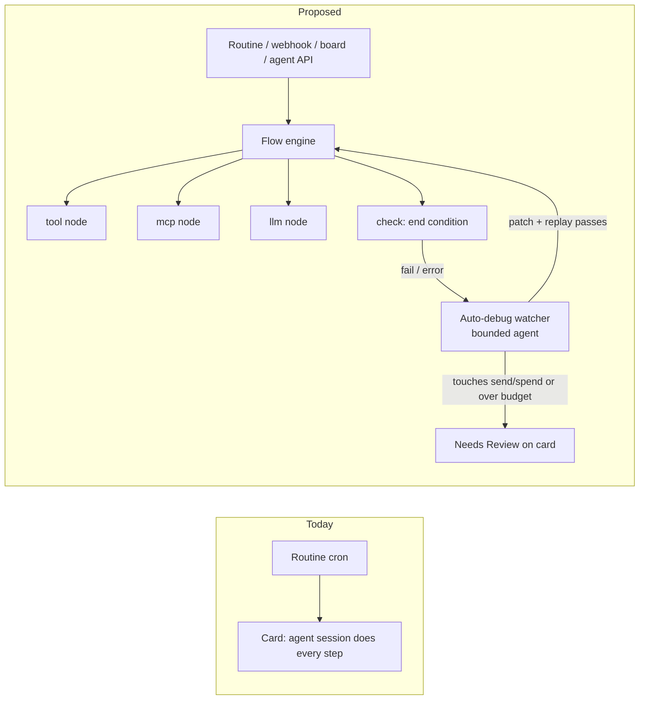
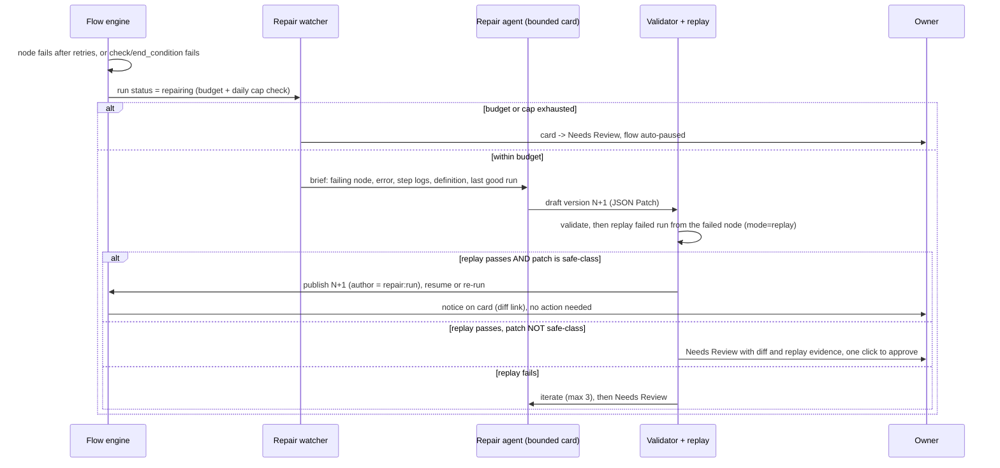
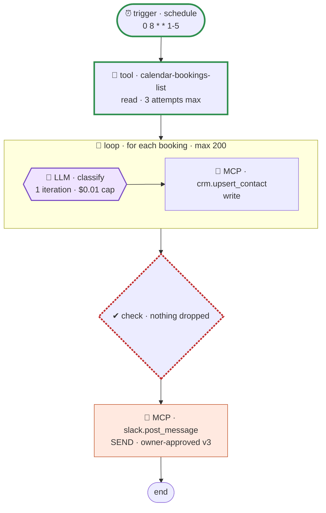

# Workflows: Jobs as agent jobs *or* goal-defined automated workflows

| | |
|---|---|
| **Status** | Draft design, for review. No product code in this PR. |
| **Objective** | #900622 |
| **Date** | 2026-11-12 |
| **Asked by** | The Operation Kit owner, 2026-11-11 |
| **Scope** | Research, recommendation, staged build cards. Nothing is built, merged or deployed by this doc. No dependency is added. |

**Short version.** A Job becomes one of two things: an **agent job** (today: a card with a full
Claude session) or a **workflow** (new: a versioned, validated JSON definition of typed nodes,
executed by a small durable engine inside our own Node server on our own SQLite). A workflow
is defined by its **goal and a machine-checkable end condition**. An agent *builds* it from the
goal, the engine *self-tests* it against fixtures and the end condition before it can be
published, and when a live run fails an **auto-debug watcher** proposes a patch, replays the
failed run against the patch, and applies it automatically only inside a budget and only if
the patch does not touch anything that sends or spends (otherwise a human approves it). People see a **read-only** n8n-style flow chart
generated from the definition with live run status on each node. We embed **no** n8n code: n8n
is under the Sustainable Use License, which is not open source and does not allow it. We adopt
no external engine either: Temporal, Hatchet, Trigger.dev and Kestra are licence-compatible but
each adds a second server and database to a one-box client install; Inngest's server is SSPL;
Windmill is AGPL. The first useful slice is small: a definition schema plus validator, an
engine that runs `tool`/`mcp`/`llm`/`check` nodes from a routine, and a Mermaid diagram (Mermaid
is already a client dependency).

---

## 1. The idea in one page

What the owner asked for, restated as requirements this doc designs against:

| # | Requirement | Where it is answered |
|---|---|---|
| R1 | A Job is either a full **agent job** (today's card session) or an **automated workflow**. | §7.1 |
| R2 | A workflow is defined by a **goal / end condition**; AI builds the workflow around it. | §3.3, §5.1 |
| R3 | It **tests itself**; an AI watcher **auto-debugs and repairs** it when a run errors. | §5 |
| R4 | Workflows can be built and tested **from the board and by agents (API / MCP)**, and show under **Jobs → Workflows**. | §7.2, §7.6 |
| R5 | Users see a **read-only** visual flow like n8n: every node, the tool/integration it uses, where the LLM loop sits. Nobody edits visually. | §6 |
| R6 | The code lives in the backend in a **standardised definition format** (like n8n's). Most nodes are simple; the LLM step is one node type. | §3 |
| R7 | Reliability: durable, retries, idempotency, step-level logs, budget ceilings, workspace isolation, human gates on send/spend. | §4, §5.4, §7 |

The core architectural bet: **the LLM is a node, not the runtime.** An agent job spends model
tokens on every step, including the trivial ones ("fetch rows, filter, post"). A workflow spends
model tokens only where the definition places an `llm` (or `agent`) node, plus during *build*
and *repair*. Everything else is plain, deterministic, replayable code. That is what makes it
cheaper, testable, and explainable in a picture.


## 2. Survey: codebases, methodologies and licenses

### 2.1 How the licenses were checked

Every row below was read from the project's **own LICENSE file at the HEAD of its default
branch on 2026-11-12** (fetched with `gh api repos/<owner>/<repo>/contents/<LICENSE>`), not
from a search summary or from GitHub's license badge. The badge was wrong or unhelpful in
five of eleven cases: n8n, Activepieces, Windmill and Inngest all report `NOASSERTION`
because their files mix licenses, and the `inngest/inngest-js` repo reports `GPL-3.0` while
its actual package file `packages/inngest/LICENSE.md` is Apache-2.0. The repository trees
were also scanned for `ee/`, `*.ee.*` and `enterprise` paths.

Operation Kit is Apache-2.0 (root `LICENSE`) and ships as one copy per client on the
client's own server (`README.md`). "Embeddable" below therefore means: *can we vendor or
bundle this code into an Apache-2.0 product that a consultant installs for a paying
client, without a commercial agreement and without changing our own license?*

### 2.2 License table

| Project | What it is | License (from the file) | Commit read | Enterprise / non-free parts | Embed in or ship with Apache-2.0 Operation Kit? |
|---|---|---|---|---|---|
| **n8n** | Visual workflow automation (TS) | **Sustainable Use License v1.0** ("fair-code") for everything except `.ee` files; `.ee` files under the **n8n Enterprise License** (`LICENSE_EE.md`). Non-`master` branches are "not licensed". | `0ab1817ba4` | **1,504** paths contain `.ee` (e.g. `packages/@n8n/ai-workflow-builder.ee`, `packages/cli/src/modules/ldap.ee`, `…/external-secrets.ee`). Note: n8n's own *AI workflow builder* is enterprise-licensed. | **NO. Not open source.** SUL limits use to "your own internal business purposes or for non-commercial or personal use" and distribution to "free of charge for non-commercial purposes". Shipping it inside a product a consultant sells is outside the grant. **Ideas only**: node/connection JSON shape, credential-by-reference, execution-data view, pinned test data. We copy no code, assets, node definitions or UI. |
| **React Flow / xyflow** (`@xyflow/react` 12.12.1) | React library for node graphs (display + editing) | **MIT** (webkid GmbH) | `1bc405cd11` | None in repo. "React Flow Pro" is a paid subscription for extra *examples*/support, not a separate code license. The small attribution link can be hidden via `proOptions`; MIT permits it, the maintainers ask Pro users to do so. | **YES.** MIT is compatible with Apache-2.0; keep the notice in `NOTICE`/third-party list. |
| **Node-RED** | Flow-based low-code runtime + editor (Node.js), OpenJS Foundation | **Apache-2.0** (root and every `packages/node_modules/@node-red/*`) | `fb9a09410b` | None | **YES, license-wise.** But its editor is jQuery/D3, not React, and its model is message-passing between always-on nodes, not a goal-checked run. Borrow: flow JSON as a flat node list with `wires`, the "debug" side panel. |
| **Kestra** | Declarative YAML orchestrator (Java 21) | **Apache-2.0** | `a2a288306e` | No `ee/` in the OSS repo; the Enterprise Edition is a separate closed image from a private registry. The OSS UI carries an `EnterpriseBadge` component that marks EE-only features. | **YES, license-wise; no, practically.** A JVM service + Postgres (H2 for dev) beside our Node server is a heavy second runtime for a single-host install. Borrow: YAML flow with typed `tasks`, `id` + `namespace`, read-only topology view generated from the YAML, plugin type strings. |
| **Activepieces** | No-code automation, "pieces" integrations (TS) | **MIT (Expat)** for everything outside `packages/ee/` and `packages/server/api/src/app/ee`; those are under the **Activepieces Enterprise License** (`packages/ee/LICENSE`, production use needs a paid licence). | `03c15c9ce4` | `packages/ee/`, `packages/server/api/src/app/ee/`, `packages/core/shared/src/lib/ee` | **Partly.** The MIT parts (e.g. individual community pieces under `packages/pieces/community/*`) can be reused with attribution. Never copy from an `ee` path. Self-host needs Postgres + Redis. Borrow: the piece contract (typed props, auth, actions/triggers). |
| **Windmill** | Scripts → flows → apps platform (Rust + Svelte) | **Mixed:** backend/ and frontend/ **AGPLv3** (with proprietary `enterprise` snippets); python/deno/go/powershell clients **Apache-2.0**; **the OpenAPI files incl. the OpenFlow spec are Apache-2.0**. The published "Community Edition" binaries include proprietary code that may not be "modif[ied] or wrap[ped]" or embedded in a distributable product without a commercial licence. | `9477036c2a` | Code behind the `enterprise` compile flag and licence-checked frontend code | **NO for the platform** (AGPL network copyleft + CE terms forbid embedding). **YES for the OpenFlow spec text** (`openflow.openapi.yaml`, Apache-2.0) as a reference for our schema. |
| **Temporal** | Durable execution server (Go) | **MIT** (server); `temporalio/sdk-typescript` also **MIT** | `03ecd1d228` | None in repo (Temporal Cloud is a hosted service, not an `ee/` tree) | **YES, license-wise.** Operationally it is a separate server with its own persistence (Cassandra / MySQL / Postgres; SQLite "only for development and testing"). Too heavy as a per-client sidecar. Borrow: deterministic replay, activity vs workflow split, idempotency keys. |
| **Hatchet** | Durable task queue / workflows on Postgres (Go) | **MIT** | `90abc499b6` | None in the code tree (only `frontend/docs/public/enterprise` screenshots for hosted features) | **YES, license-wise.** Needs Postgres (RabbitMQ optional; `hatchet-lite` image for low throughput). We run SQLite, so adoption = a second database. Borrow: DAG-of-steps with per-step retries/timeouts, concurrency keys. |
| **Trigger.dev** | Background jobs / durable tasks for TS | **Apache-2.0** | `7a2a7dc801` | No `ee/` paths | **YES, license-wise.** Self-host is a webapp + Postgres + Redis + registry + object store + supervisor machine (docs: 3+ vCPU/6 GB webapp, 4+ vCPU/8 GB worker). Far beyond one small client box. Borrow: `task()` with `retry`, `idempotencyKey`, `wait.for`/`wait.forToken` (human-in-the-loop tokens). |
| **Inngest** | Event-driven durable step functions | Server: **SSPL v1.0** with a **"Grant of Future License"** to Apache-2.0 effective three years after each release (a delayed-open-source licence). TS SDK (`packages/inngest`): **Apache-2.0**. | `ff6ab64472` | No `ee/`; the restriction is the SSPL itself | **NO for the server** (SSPL obligations on offering it as a service are incompatible with how consultants deliver Operation Kit; a 3-year-old build is the only Apache-2.0 option). The SDK alone is useless without the server. Borrow: `step.run` / `step.sleep` / `step.waitForEvent` memoisation model. |
| **CNCF Serverless Workflow → "Open Workflow Specification"** | Vendor-neutral workflow DSL (YAML/JSON) + JSON Schema + CTK | **Apache-2.0** (spec); `sdk-typescript` **Apache-2.0** | `3e2eefc44e` | None | **YES.** It is a spec, so we can implement a subset. Note: the repo **moved** from `serverlessworkflow/specification` to `open-workflow-specification/specification` and the DSL is now called the *Open Workflow DSL*. Latest release `v1.0.3` (2026-07-31); `main` documents `dsl: 1.0.4`, which adds **`call: mcp`** and **`call: a2a`**. |

Layout helpers for the viewer (§6): **dagre** (`dagrejs/dagre`) is **MIT** — usable.
**elkjs** is **EPL-2.0** — weak copyleft, avoid unless we need its edge routing.

### 2.3 Methodologies worth borrowing (independent of license)

| Idea | Seen in | What we take |
|---|---|---|
| Durable execution by **step memoisation**: each step's output is persisted; a re-run replays finished steps from the log instead of re-executing them | Inngest `step.run`, Trigger.dev, Temporal activities | Our engine persists each node's output in `workflow_step_runs`; resume after a crash skips completed nodes. |
| **Idempotency key per side-effect** | Trigger.dev `idempotencyKey`, Temporal activity IDs | Every node that sends or spends gets `run_id:node_id:attempt`-derived keys passed to the tool. |
| **Typed, closed node vocabulary** described by a schema | Kestra task `type`, Windmill OpenFlow module kinds, Open Workflow DSL tasks | A small closed set of node kinds (§3) validated by one JSON Schema. |
| **Wait-for-token / suspend for approval** | Trigger.dev `wait.forToken`, Windmill `suspend`, Open Workflow `listen` | `approval` gate = a `wait` node resumed by an owner click on the card. |
| **Pinned test data / mocks per node** | n8n pinned data (idea only), Windmill module `mock` | `fixtures` block in the definition; dry-run uses them instead of live calls. |
| **Failure handler module** | Windmill `failure_module`, Open Workflow `try/catch` | Not a user node: our failure handler *is* the auto-debug watcher (§5). |
| **Read-only topology generated from code** | Kestra topology view, Temporal UI timeline | Viewer is a pure function of the definition + run log; nobody edits the picture. |
## 3. Recommendation (a): workflow definition format

### 3.1 Decision

**Our own JSON schema, `okflow/1`, whose node kinds are a deliberate, mappable subset of the
Open Workflow DSL (ex-CNCF Serverless Workflow), plus three things that DSL does not have: a
goal/end-condition block, an `llm` node and an `agent` node, and an `effect` class on every
node.** JSON, not YAML, and validated by a hand-written TypeScript validator in
`app/shared/flow/` (no new dependency).

Why not adopt the Open Workflow DSL as-is:

| Concern | Open Workflow DSL 1.0.x | `okflow/1` |
|---|---|---|
| Licence | Apache-2.0, fine | ours, Apache-2.0 |
| Conformance cost | A conforming runtime must implement **all 12** task types (call, do, emit, for, fork, listen, raise, run, set, switch, try, wait) and its expression language (jq by default). We would ship a permanently non-conformant subset, or add a jq engine. | 10 node kinds, all implemented; references are a tiny path syntax, no `eval`, no jq |
| Goal / end condition | none (a workflow ends when its tasks end) | first-class `goal` with machine-checkable `end_condition` (§3.3) |
| LLM / agent step | none; `call: mcp` and `call: a2a` exist only on `main` (`dsl: 1.0.4`, unreleased as of v1.0.3) | `llm` and `agent` are node kinds with their own budget fields |
| Side-effect class (for approval gates and dry-run stubbing) | none | `effect: read \| write \| send \| spend` on every node |
| Credentials | inline `authentication` blocks (examples embed tokens) | **names only**, resolved by the existing connector credential path (§7.4) |
| Dependencies | YAML parser + jq + JSON Schema validator | none |

We keep the DSL as the **reference vocabulary** and propose an `okflow → Open Workflow`
exporter as a late, optional card (B10) so a definition is never locked in. Windmill's OpenFlow
(Apache-2.0 spec file `openflow.openapi.yaml`) and Kestra's typed tasks are the other two
references; n8n's `nodes[] + connections{}` JSON is an *idea* reference only (no text copied).

**Naming.** "Workflow" is already taken in code: `app/shared/workflow.ts` is the objective
status-transition engine and `objectives.workflow_hint` exists. The product surface says
**Workflows**; the code namespace is **`flow`** (`app/shared/flow/`, tables `flow_*`,
routes `/api/flows`) so grep stays unambiguous.

### 3.2 Node kinds (closed set)

| Kind | Purpose | Key fields | Default `effect` | Maps to Open Workflow |
|---|---|---|---|---|
| `trigger` | How a run starts. Exactly one, first. | `on: schedule \| webhook \| manual \| board \| event`; `schedule.cron` (reuses routine cron) | read | `schedule` / `listen` |
| `tool` | Call an **OperationKit Tool** from the registry (`okit` Tools layer): HTTP API, script, internal API | `tool: <registry slug>`, `input` | from Tool metadata; **unknown ⇒ `send`** | `call: http` / `run` |
| `mcp` | Call a tool on a **connector's MCP server** | `connector: <id>`, `tool: <name>`, `arguments` | from connector tool annotation (`readOnlyHint`) else `send` | `call: mcp` (1.0.4) |
| `llm` | One bounded model call with a typed output; may run a short tool loop | `prompt`, `output_schema`, `model`, `max_iterations` (default 1, cap 8), `tools[]` (optional, read-only only), `budget_usd` | read (the call itself); spend is counted | no equivalent |
| `agent` | Hand a sub-goal to a **full agent session** (a child card) and wait for its result | `brief`, `agent`, `budget_usd`, `timeout` | inherits card rules | no equivalent (closest: `call: a2a`) |
| `branch` | If / switch on data | `cases[{when, then: [node ids]}]`, `default` | — | `switch` |
| `loop` | For-each over a list, sequential or bounded-parallel | `over`, `as`, `body: [node ids]`, `max_items` (required), `concurrency` (≤ 4) | — | `for` |
| `wait` | Duration, until-time, external event, or **approval** | `for` / `until` / `event` / `approval: {from: owner, prompt}` | — | `wait` / `listen` |
| `check` | Assert a condition; the end-condition evaluator | `assert[]` (§3.3), `on_fail: fail \| repair \| continue` | — | `raise` on failure |
| `end` | Terminal; names the run output | `output` | — | end of `do` |

Every node also carries: `id` (stable, `^[a-z][a-z0-9_]{0,40}$`), `label`, `next` (or the
branch/loop structure), `retry: {max, backoff: fixed|exponential, delay_ms}`, `timeout_ms`,
`idempotency: auto | none` and optional `mock` (the fixture used in dry-run).

Data references are a **path syntax only**: `{{ trigger.payload.x }}`, `{{ steps.<id>.output.y }}`,
`{{ item.z }}` (inside a loop), `{{ secrets.NAME }}` is **rejected** by the validator (secrets
never appear in a definition; tools resolve their own credentials). Allowed pure functions are a
small fixed list (`len`, `now`, `date_add`, `lower`, `join`, `default`). No arbitrary code
inside a definition: code lives in **Tools**, which are already authored, validated and
registered through `okit` (`app/server/src/routes/internal-operationkit.ts`).

### 3.3 Goal and end condition

```jsonc
"goal": {
  "statement": "Every booking created yesterday is in the CRM with a category, and the team got one summary message.",
  "end_condition": {
    "assert": [
      { "expr": "len(steps.fetch.output.bookings) == steps.upsert.output.count", "why": "nothing dropped" },
      { "expr": "steps.notify.output.ok == true", "why": "summary posted" }
    ],
    "judge": {                      // optional, never the only check
      "rubric": "The message states how many bookings were triaged and nothing else.",
      "on": "steps.notify.input.text",
      "budget_usd": 0.05
    }
  }
}
```

Rules: at least one deterministic `assert` is required (a judge-only goal fails validation); the
end condition is evaluated by the **engine**, never by the agent that built or repaired the flow;
and the auto-debug loop may **not** edit `goal` (§5.3).

### 3.4 Versioning and validation

- `apiVersion: "okflow/1"` on every document. A breaking schema change becomes `okflow/2` with a
  migration function; the validator accepts every version it knows how to migrate.
- Each workflow has an integer `version`. **Published versions are immutable.** Edits (human,
  builder agent or auto-debug) create a new **draft** version; a run always pins the exact
  version it started on (`flow_runs.version`).
- The stored row keeps the canonical JSON, its SHA-256, the author (`user:<id>`,
  `agent:<objective id>`, `repair:<run id>`), the parent version, and a JSON-Patch diff from the
  parent, so the viewer can highlight what changed.
- Validation (one function, used by API, MCP, builder and CI tests) checks: schema shape; unique
  ids; exactly one trigger; graph is connected and acyclic outside `loop`; every reference
  resolves to an upstream node; every `tool` slug exists in the registry and every `connector`
  exists and is enabled for the workspace; `loop.max_items` present; `llm.max_iterations` ≤ 8;
  every `send`/`spend` node is either preceded by an approval `wait` (per-run approval) or listed
  in the owner's `approvals` record for **this exact version** (per-version approval, §5.4);
  at least one deterministic assert.

### 3.5 A complete example

```jsonc
{
  "apiVersion": "okflow/1",
  "id": "daily-booking-triage",
  "name": "Daily booking triage",
  "workspace": "acme",                       // a hard filter, see §7.5
  "version": 3,
  "goal": { /* as in §3.3 */ },
  "budget": { "run_usd": 0.50, "repair_usd": 2.00, "repairs_per_day": 3 },
  "approvals": { "version": 3, "nodes": ["notify"], "by": "user:1", "at": "2026-11-20T14:02:00Z" }, // owner-only, §5.4
  "nodes": [
    { "id": "start",    "kind": "trigger", "on": "schedule", "schedule": { "cron": "0 8 * * 1-5" }, "next": "fetch" },
    { "id": "fetch",    "kind": "tool",  "tool": "calendar-bookings-list", "effect": "read",
      "input": { "since": "{{ date_add(now(), -1, 'day') }}" }, "retry": { "max": 3, "backoff": "exponential", "delay_ms": 2000 },
      "mock": { "output": { "bookings": [ { "id": "b1", "notes": "pricing question" } ] } }, "next": "each" },
    { "id": "each",     "kind": "loop", "over": "{{ steps.fetch.output.bookings }}", "as": "b", "max_items": 200,
      "body": ["classify", "upsert_one"], "next": "upsert" },
    { "id": "classify", "kind": "llm", "model": "default", "max_iterations": 1, "budget_usd": 0.01,
      "prompt": "Classify this booking note into one of: sales, support, other. Note: {{ item.b.notes }}",
      "output_schema": { "type": "object", "properties": { "category": { "enum": ["sales","support","other"] } }, "required": ["category"] } },
    { "id": "upsert_one", "kind": "mcp", "connector": "crm", "tool": "upsert_contact", "effect": "write",
      "arguments": { "external_id": "{{ item.b.id }}", "tag": "{{ steps.classify.output.category }}" } },
    { "id": "upsert",   "kind": "check", "assert": [ { "expr": "len(steps.each.output) == len(steps.fetch.output.bookings)" } ],
      "on_fail": "repair", "next": "notify" },
    { "id": "notify",   "kind": "mcp", "connector": "slack", "tool": "post_message", "effect": "send",
      "arguments": { "channel": "#bookings", "text": "Triaged {{ len(steps.fetch.output.bookings) }} bookings." }, "next": "done" },
    { "id": "done",     "kind": "end", "output": "{{ steps.each.output }}" }
  ]
}
```

`notify` is a `send` node with no approval `wait` in front of it, so this version can only be
published with the owner's per-version approval recorded against `notify` (§5.4). A version 4
that changed `notify` would need that approval again.
## 4. Recommendation (b): execution engine

### 4.1 Decision

**Build a small durable engine inside the existing Node server, persisted in the existing
SQLite database, reusing our job accounting, leases, scheduler and kill-switch conventions.
Borrow the durable-execution *model* (step memoisation, idempotency keys, wait tokens) from
Inngest/Trigger.dev/Temporal; adopt none of their servers.** Revisit only if a client needs
multi-host execution or sustained throughput above roughly one node-execution per second
(see §4.5 for the trigger).

### 4.2 Tradeoffs for a single-host self-install

Operation Kit ships one copy per client on a server the client owns, already running our Node
process, SQLite, tmux sessions and Caddy. Every extra stateful service is something a
consultant installs, backs up, upgrades and debugs at that client.

| Option | Licence fit | What it adds to each client box | Durability model | Verdict |
|---|---|---|---|---|
| **Own engine on our SQLite** | ours | nothing | step memoisation in `flow_step_runs`, lease per run, resume on boot | **Recommended.** Smallest footprint, one backup, one auth model, reuses ceilings and workspace filters directly. Cost: we own the correctness of the engine, so it stays deliberately small (10 node kinds, no arbitrary code). |
| Temporal | MIT | Temporal server (Go) + Postgres/MySQL/Cassandra (SQLite is "only for development and testing") + workers | deterministic workflow replay | Gold standard, wrong size. Determinism rules leak into every node author's code. |
| Hatchet | MIT | Hatchet engine + Postgres (RabbitMQ optional; `hatchet-lite` for low throughput) | durable DAG steps on Postgres | Good fit conceptually, but a second database beside SQLite. |
| Trigger.dev | Apache-2.0 | webapp + Postgres + Redis + registry + object store + supervisor; docs size it at 3+ vCPU/6 GB plus 4+ vCPU/8 GB | checkpoint/restore of task containers | Far too heavy per client. |
| Inngest | **SSPL** server (Apache-2.0 after 3 years); Apache-2.0 SDK | single binary with SQLite + in-memory Redis (lightest of the externals) | `step.*` memoisation | Lightest footprint, but SSPL rules it out for something we ship. Copy the model, not the code. |
| Kestra | Apache-2.0 | JVM service + Postgres (H2 for dev) | queue + executor on DB | A second runtime in a second language. |
| Windmill / n8n / Activepieces as the engine | AGPL+proprietary / SUL / MIT core + EE | their whole platform + Postgres (+ Redis) | their own | Licence (Windmill, n8n) or footprint (Activepieces) rules them out as the engine. n8n stays an **integration target** (`app/server/src/connectors/defs/n8n.ts` already says "not a competing orchestrator for this app"). |

### 4.3 Engine shape

New tables (drafted here, created in card B1/B2; `app/server/src/db/schema/flow.ts`):

| Table | Purpose |
|---|---|
| `flow_definitions` | `id`, `workspace` (**NOT NULL**, unlike `routines`), `name`, `status` (`draft \| active \| paused \| archived`), `published_version`, `created_by`, timestamps |
| `flow_versions` | `flow_id`, `version`, `definition_json`, `sha256`, `author`, `parent_version`, `patch_json`, `validation_json`, `self_test_run_id`, `approvals_json`, `created_at` |
| `flow_runs` | `id`, `flow_id`, `version`, `mode` (`live \| dry \| replay`), `trigger_json`, `status` (`queued \| running \| waiting \| succeeded \| failed \| repairing \| cancelled`), `goal_met` (0/1/NULL, separate from `status`), `spent_usd`, `lease_owner`, `lease_expires_at`, `parent_run_id` (for replays), `objective_id` (home card), timestamps |
| `flow_step_runs` | `run_id`, `node_id`, `iteration` (loop index), `attempt`, `status`, `input_json`, `output_json` (size-capped, redacted), `error_json` (Problem-Details shape: `type`, `title`, `detail`, `node_id`), `idempotency_key`, `cost_usd`, `started_at`, `ended_at` — **this is the step-level log** |
| `flow_wait_tokens` | `token` (hashed), `run_id`, `node_id`, `kind` (`approval \| event \| until`), `expires_at`, `resolved_by`, `resolved_at` |

Execution rules:

1. **Lease, not lock.** A run is claimed with a lease `flow:<run_id>` (same pattern as the
   `obj:<id>` identity lease in `services/objective-session-claim.ts`). A backend restart
   (`self-deploy.sh backend`) drops leases; on boot the engine re-claims every `running` run whose
   lease expired and **resumes from the first node without a `succeeded` step row**. Completed
   steps are never re-executed: their stored output is replayed (memoisation).
2. **Idempotency.** Each side-effecting node gets `idempotency_key = sha256(run_id, node_id,
   iteration)` (stable across attempts) passed to tools that accept one. A `send`/`spend` node
   whose step row is `running` at crash time is **not** retried automatically unless its Tool
   declares idempotency support; otherwise the run goes to `waiting` with an "unknown outcome,
   confirm" approval. That rule is what stops a restart from double-sending an email.
3. **Retries and timeouts** per node (`retry`, `timeout_ms`), defaulting to 3 attempts,
   exponential backoff from 2 s, 60 s timeout; `llm` 120 s; `agent` uses the card's own limits.
4. **Waits are rows, not sleeping promises.** `wait` writes a `flow_wait_tokens` row and sets the
   run to `waiting`; a scheduler tick, a webhook or an owner click resolves it. A run can wait
   for days across restarts.
5. **Concurrency.** A global cap (`settings.flow_max_concurrent_runs`, default 4) and a per-flow
   cap (default 1, so a slow schedule never piles up — the same guard idea as
   `routines.max_queue_depth`). `llm` and `agent` nodes also respect the session cap
   (`lib/session-cap.ts`) and the account pool.
6. **Daemon discipline.** The engine tick is a host daemon: it does **not** start under
   `CC_SCRATCH_SERVER=1` (`services/scratch-instance.ts`), it has a kill switch
   `settings.flows_enabled` (mirrors `routines_enabled`), and it writes a heartbeat like the
   routine scheduler.
7. **Logs.** Every node transition writes a `flow_step_runs` row and a WebSocket broadcast (for
   the viewer overlay). Lifecycle milestones also go to `activity_log` using **existing**
   `event_type`s with `metadata.kind` = `flow_run_started | flow_run_failed | flow_repaired |
   …` (the CHECK constraint forbids new event types; see `db/schema/session.ts`).

### 4.4 Where each node kind executes

| Node | Executor |
|---|---|
| `tool` | The Tool's registered runner (HTTP call, or `script` in a child process with the same output caps as `services/routine-script.ts`), with credentials resolved by name through the connector credential path (§7.4). |
| `mcp` | An MCP client call to the connector's server, with the connector's stored credential. |
| `llm` | The existing server-side model path (`services/llm-gateway/claude-cli-backend.ts`, as used by `services/doc-ingest/llm.ts`), output parsed against `output_schema`; a parse failure is a retryable step error. Optional tool loop capped by `max_iterations`, read-only tools only. |
| `agent` | Creates a **child objective** (a normal card, `origin` = workflow) with the brief, waits on a `flow_wait_tokens` row resolved by the card's `job_disposition` / `done`. All existing card machinery (worktree, ceilings, review, stall watchdog) applies unchanged. |
| `branch`/`loop`/`check`/`end` | Pure engine code. |

### 4.5 When to revisit

Move to an external engine (Hatchet is the first candidate: MIT, Postgres, DAG-native) only if
one of these becomes true for a real client: runs must survive a host failure (multi-host),
sustained > ~1 node-execution/second, or definitions need workers in another language. The
`okflow/1` format is the contract; the executor behind it is replaceable.
## 5. Recommendation (c): self-test and auto-debug loops

Two loops, one shared mechanism: **run the definition in a mode that cannot cause harm, and let
the engine — not the model — decide whether the goal was met.**

### 5.1 Build loop (goal → definition)

A workflow is born on a card. "New workflow" (board, Jobs → Workflows, or the agent API /
MCP) creates a **builder card**: a normal objective whose brief is the goal, the end condition
(or a request to propose one), the workspace's Tool registry (`GET
/api/internal/operationkit/registry`) and its enabled connectors. The builder agent:

1. Proposes the `goal.end_condition` if the human did not write one. The human confirms it
   (this is the contract; the builder cannot change it afterwards without the human).
2. Writes a draft version via `POST /api/flows/:id/versions`. The validator answers
   synchronously with every error at once.
3. Runs the **self-test** (§5.2) and iterates on validation/self-test failures, up to
   `builder.max_iterations` (default 6) and the card's normal cost ceiling.
4. Requests publish. Publish needs a human click when the version contains any `send`/`spend`
   node (always true for the first publish of most real flows). Publishing records
   `approvals` against exactly the nodes reviewed (§5.4).

### 5.2 Self-test (dry-run against the goal)

| Mode | `read` nodes | `write` nodes | `send`/`spend` nodes | `llm` | Purpose |
|---|---|---|---|---|---|
| `dry` | `mock` output | `mock` output | `mock` output, **recorded as "would send …"** | live, small budget (or `mock`) | Structure, references, branch coverage, end condition. Zero side effects. |
| `test` | **live** | stubbed (or a declared sandbox target) | stubbed | live | Real data shapes from real read APIs, still no external effect. |
| `replay` | recorded outputs from a previous run, up to a chosen node; live (or stubbed by effect) after it | per effect | stubbed | live | Auto-debug (§5.3): re-run a failed run against a patched definition. |

Fixtures: every node may carry `mock`; the builder is required to write mocks for every
`write`/`send`/`spend` node, and the validator rejects a publish without them. A `fixtures`
set can hold several trigger payloads (for example an empty list, a normal day and a
200-item day) so `dry` runs exercise branches and loop bounds.

**Pass criteria, evaluated by the engine:** every node reachable on at least one fixture
completed; every deterministic `goal.end_condition.assert` is true on the `test` run; the
optional `judge` (a separate, small `llm` call that sees only the rubric and the named output)
passes; spend stayed under `budget.run_usd`. The result is stored as `self_test_run_id` on the
version. **No green self-test, no publish.**

### 5.3 Auto-debug loop (run error → patch → replay → apply)



What the repair agent receives (all from `flow_step_runs`, size-capped and redacted): the
failing node's input, error (Problem-Details shape), attempt history, the outputs of its
upstream nodes, the same node's input/output from the last successful run, and the
definition. It returns only a JSON Patch against the definition plus a one-paragraph
explanation. It does **not** get credentials and cannot call send/spend tools; it runs as a
child card with `agent` limits, so worktree isolation, stall watchdog and job ceilings apply.

**Safe-class patches (may auto-apply):** change a node's `input`/`arguments` mapping, a
`retry`/`timeout`, a `branch` condition, a `loop.max_items` *decrease*, an `llm` prompt or
`output_schema`, add a read-only `tool`/`mcp` node, or add a `check`.

**Never auto-applied (always Needs Review):** anything that adds, removes or changes a
`send`/`spend` node or its arguments; adds a connector or Tool not already used; raises any
budget, cap or `loop.max_items`; touches `approvals`, `workspace`, `trigger`; or touches
`goal` in any way. The last rule is the important one: **a repair agent may never weaken the
end condition to make its own test pass.**

**Budgets and circuit breakers:**

- `budget.repair_usd` per incident (default $2) and `budget.repairs_per_day` (default 3) per
  workflow, both counted in the same ledger as job ceilings (§7.3).
- Same failure signature (node id + error type) repaired twice in 7 days ⇒ the third goes to
  Needs Review (a loop that keeps "fixing" the same thing is a bug in the fix).
- K consecutive failed runs ⇒ the workflow auto-pauses, reusing the semantics and the banner of
  `services/routine-auto-pause.ts` (K from `settings.routine_auto_pause_failures`, default 5).
  A `127`/`ENOENT` from a `script` Tool is classified as **definition rot**, not a transient
  failure, and opens a repair immediately rather than counting toward K (the lesson recorded in
  CLAUDE.md for routines).
- After a repaired version publishes, a failed run is either **resumed** from the failed node
  (when every already-completed node is idempotent or read-only) or **re-run** from the
  trigger in a new run (default). A run never mixes two versions.

### 5.4 Human approval gates (send / spend)

| Gate | When | Who can satisfy it |
|---|---|---|
| **Per-version publish approval** | Publishing any version whose `send`/`spend` node set or arguments differ from the last approved version. | Owner/admin via cookie session in the UI (same rule as `verified_sender_stamps`: a `VERIFIED … (owner, typed in UI)` principal). Never an agent key, never the builder or repair agent. |
| **Per-run approval** | An approval `wait` node in front of a `send`/`spend` node (for one-off or high-stakes sends). | Same. The card shows "Approve / Reject" with the exact payload that will go out. |
| **Unknown-outcome confirm** | A non-idempotent `send`/`spend` step was in flight during a crash. | Same. |
| **Budget raise** | A repair or run wants more than its budget. | Same; the new number is recorded. |

These gates exist so that "AI auto-debugs it" can never mean "AI started emailing people in a
new way at 3 a.m."
## 6. Recommendation (d): read-only viewer

### 6.1 Decision

**Two steps, both read-only, both a pure function of `(definition, run log)`:**

1. **V1 — Mermaid (zero new dependencies).** A `definitionToMermaid()` function in
   `app/shared/flow/` turns any `okflow/1` definition into a `flowchart TD`, rendered by the
   client's existing lazy Mermaid path (`app/client/src/lib/mermaid.ts`,
   `components/docs/MermaidBlock.tsx`; `mermaid` is already in `app/client/package.json`).
   Node shapes and `classDef`s encode kind, effect and last-run status. Good enough to ship
   the "see the flow" promise with the first engine slice.
2. **V2 — React Flow (`@xyflow/react`, MIT) + dagre (MIT).** Added in its own card (B7) as
   the **only** new dependencies in this plan, when we need live per-node overlays, a click-to-
   inspect side panel, collapsible loop groups, and version diffs. Both are licence-clean for
   Apache-2.0 (attribution in `NOTICE`). Avoid elkjs (EPL-2.0) unless dagre's layout proves
   inadequate.

### 6.2 What the viewer shows



| Element | Rendering rule |
|---|---|
| Node kind | Icon + shape per kind: trigger = stadium, `tool` = box, `mcp` = box with connector logo/name, `llm` = hexagon with a distinct colour (**"where the LLM loop sits"**, showing model, `max_iterations`, budget), `agent` = double-border box labelled "agent session → card #id", `branch` = diamond, `check` = diamond with ✔, `wait` = clock, `end` = stadium. |
| Tool / integration | Subtitle line: Tool registry slug or `connector.tool`; connector icon when known. |
| Effect | Badge `read · write · SEND · SPEND`; send/spend outlined in the warning colour, with "owner-approved vN" or "approval each run". |
| Loop | Group/subgraph containing its body, with `max_items` and concurrency. |
| Run overlay | Per-node border colour = status of that node in the selected run (`succeeded`, `failed`, `running`, `waiting`, `skipped`, `mocked`); counts for loops ("183/200 ok, 2 failed"); duration and cost. |
| Click a node (V2) | Side panel: config, last input/output (redacted, capped), error, attempts, and the same node in the last good run. |
| Versions | Version picker; nodes changed vs the previous version are tagged (`changed by repair:run-123`). |
| Read-only | React Flow with `nodesDraggable=false`, `nodesConnectable=false`, `elementsSelectable=true`, no edit toolbar. Layout comes from dagre top-to-bottom, recomputed from the definition every time, so there is no stored layout to drift. |

Redaction in the panel reuses the live-artifact redactor (`services/live-redaction.ts`); a step's
input/output is redacted at write time as well, so the database never holds a token a tool
echoed back.
## 7. Fit with existing Operation Kit concepts

Current state, as it exists in the code today (file references are the anchors the build
cards extend):

| Concept | Today | File |
|---|---|---|
| Job | An objective with `routine_id IS NOT NULL`; no separate job-run table. Lanes: Running / Needs Review / Complete via `laneOf()`. Admin-only, cross-workspace page at `/jobs`. | `app/client/src/components/JobsBoard.tsx`, `app/server/src/routes/admin-jobs.ts`, `db/index.ts` (`job_disposition`, `job_review_note`, `source_job_id`) |
| Routine | `routines` row: `cron_expr`, `objective_template` JSON, `kind` `ai \| script`, `script_command`, `alert_marker`, auto-pause columns. **No `workspace` column** (it lives inside `objective_template`). | `db/schema/kitchen.ts`, `services/routine-scheduler.ts` (`tick`, `fireRoutine`, `fireAiRoutine`, `runScriptRoutine`), `services/routine-script.ts`, `services/routine-auto-pause.ts` |
| Budget ceilings | Per-objective cost + wall-clock ceilings with `enforce \| observe \| off` policy, resolved objective → workspace → global; spawn-level `MAX_BUDGET_*`. | `db/schema/job-accounting.ts`, `services/job-accounting.ts` (`job_cost_ceiling_usd[:ws]`, `job_wallclock_ceiling_ms`, `job_ceiling_policy`, `guardAutoStartCeiling`), `config.ts` |
| Integrations | Connector registry (`auth_path`: `dcr_mcp \| oauth_guided \| api_key \| self_hosted_aggregator`), Sprint 7 catalog; one credential path from connector → Tool `auth.secrets[].env` → `canUseConnectorCredential` → env. | `connectors/registry.ts`, `connectors/types.ts`, `services/connector-guard.ts`, `services/session-spawn-env.ts`, `docs/connectors/TOOLS-LAYER-WIRING.md` |
| Tools registry | `okit` Tools → Skills → Agents, exposed via `/api/internal/operationkit/*`. | `routes/internal-operationkit.ts` |
| Agent API / MCP | `POST /api/mcp`; every MCP tool is a loopback adapter over a public REST route; scopes in `AGENT_SCOPES`. | `routes/agent-mcp.ts` (`MCP_TOOLS`), `api/agent-openapi.ts`, `app/shared/types-surfaces.ts` |
| Isolation | Session principal (`CC_SESSION_TOKEN`) scoped to one workspace; KB retrieval is a hard workspace filter. | `middleware/internal-board-auth.ts`, `lib/session-trust.ts`, `middleware/workspace.ts` |
| Step logs today | `objective_progress` snapshots, `activity_log` (CHECK-constrained `event_type`), session jsonl. | `db/schema/live-progress.ts`, `db/schema/session.ts`, `services/session-jsonl.ts` |
| n8n | Already a **connector** (API key + webhook), "an automation TARGET … not a competing orchestrator", plus an `n8n-watchdog`. | `connectors/defs/n8n.ts`, `services/n8n-watchdog.ts`, `routes/n8n.ts` |

### 7.1 Jobs = agent jobs ∪ workflow runs (R1)

- A **routine gains a third kind: `kind='flow'`** with a `flow_id`. The scheduler's `tick()`
  already branches on `kind` (`fireAiRoutine` vs `runScriptRoutine`); `flow` calls
  `startFlowRun(flow_id, {trigger: 'schedule'})`. Run-now, resume, the over-fire guard and
  auto-pause all come for free. A flow's `trigger.on='schedule'` *is* this routine row (one
  source of truth for the cron), created/updated when the flow is published.
- A `script` routine is, in effect, a one-node workflow. We do **not** migrate them; a later
  card may offer "convert to workflow".
- The **Jobs page** gets a kind filter (All · Agent jobs · Workflows) and a **Workflows** tab.
  A workflow run appears in the same three lanes: Running (`queued/running/waiting/repairing`),
  Needs Review (`failed` with a pending repair approval, or `goal_met = 0`), Complete.

### 7.2 Board cards (R4)

- Each workflow has a **home card** (an objective, `type='workflow'`, linked by
  `flow_definitions.objective_id`). That is where the builder works, where repair proposals and
  approvals land (Needs Review), and where the viewer is embedded as a tab. Chat on the home
  card reaches the builder/repair agent, with the existing `[cc-sender]` provenance rules.
- Individual **runs do not create cards** (that is the point: no session per run). Only an
  `agent` node, a repair, or a failure needing a human produces a child card.

### 7.3 Budget ceilings

- Each run is accounted in the **same ledger** as job ceilings. `flow_runs.spent_usd` is summed
  from `llm` node costs plus child `agent` cards (which already account themselves) plus repair
  cards, and checked against `budget.run_usd` before every `llm`/`agent` node.
- Workspace and global ceilings (`job_cost_ceiling_usd:<workspace>`, `job_ceiling_policy`)
  apply on top; the stricter wins. `observe` policy logs without stopping, as today.
- Repair spend has its own `budget.repair_usd` + `repairs_per_day` (§5.3) so a broken flow
  cannot burn the month's budget repairing itself.

### 7.4 Integrations / MCP connectors (Sprint 7)

- `mcp` nodes reference `connector` by **id** from `connectors/registry.ts`; `tool` nodes
  reference a Tool **slug** from the `okit` registry. The validator checks both exist and are
  enabled for the workflow's workspace.
- Credentials resolve through the **one credential path** in `TOOLS-LAYER-WIRING.md`
  (`readCredential()` → `canUseConnectorCredential()`), with the workflow's workspace as the
  scope. A definition never contains a secret value or `{{secrets.*}}`; the validator rejects it.
- Read-only vs side-effecting comes from Tool metadata and MCP tool annotations
  (`readOnlyHint` / `destructiveHint`); when unknown, the node is classed `send` (fail safe).
- n8n stays a connector: a node can call an n8n webhook or API. Operation Kit does not import
  or execute n8n workflow JSON.

### 7.5 Workspace isolation

- `flow_definitions.workspace` is **NOT NULL** and is a hard filter on every read and write
  route (same discipline as `applyPrincipalWorkspaceFilter` in
  `middleware/internal-board-auth.ts`). A session token can only see and run flows of its own
  card's workspace; a cross-workspace request is a loud 403.
- Credentials, connectors, Tools and KB retrieval inside a run are all resolved for that
  workspace. A run never inherits the triggering user's broader access.
- The Jobs page stays admin/cross-workspace as today, filtered by its own `wsFilter`.

### 7.6 Agent API and MCP (R4)

REST first (the `agent-mcp.ts` rule: every MCP tool wraps a public route), then MCP tools:

| REST | MCP tool | Scope |
|---|---|---|
| `GET /api/flows`, `GET /api/flows/:id` | `list_workflows`, `get_workflow` (definition + Mermaid text) | `board:read` |
| `POST /api/flows` (goal → builder card) | `create_workflow` | `board:write` |
| `POST /api/flows/:id/versions` (draft) + `POST /api/flows/validate` | `draft_workflow_version`, `validate_workflow` | `board:write` |
| `POST /api/flows/:id/test` (`dry`/`test`) | `test_workflow` | `board:start` |
| `POST /api/flows/:id/runs` | `run_workflow` | `board:start` |
| `GET /api/flows/:id/runs/:run` (+ step rows) | `get_workflow_run` | `board:read` |
| `POST /api/flows/:id/publish` | — (no MCP tool) | **cookie owner/admin only** |

Publish and approvals are deliberately **not** exposed to agent keys: an outside agent can build
and test a workflow but a human publishes anything that sends or spends. A dedicated
`board:workflows` scope can be split out later if a client wants agents that read but never draft.
## 8. Staged build cards

Smallest useful slice first. Sizes: **S** ≈ one worker session, ≤ ~400 lines incl. tests;
**M** ≈ 1–2 sessions; **L** ≈ 3+ sessions or a fan-out. Every card ships its own PR through
`gate` and leaves the feature **off by default** behind `settings.flows_enabled` until B4.

**Slice 1 (B1–B4) is the first useful product:** a human (or the builder agent, by hand) can
write a JSON workflow that reads via a Tool, classifies with an LLM, checks an end condition,
runs on a schedule, and is visible as a diagram under Jobs → Workflows. No auto-build, no
auto-repair yet.

| Card | Scope | Acceptance criteria | Size | Depends on |
|---|---|---|---|---|
| **B1 — `okflow/1` schema + validator** | `app/shared/flow/` types, `validateFlow()` (all rules in §3.4 except registry lookups, which take an injected resolver), `definitionToMermaid()`. No server, no UI. | Unit tests: the §3.5 example validates; ≥ 15 negative fixtures each fail with a specific error code (duplicate id, two triggers, dangling reference, cycle outside loop, missing `loop.max_items`, `llm.max_iterations` > 8, `{{secrets.X}}` present, judge-only goal, unapproved send node …); Mermaid output snapshot-tested. No new dependency. | S | — |
| **B2 — Engine core: tables + `tool`/`check`/`branch`/`end`** | `db/schema/flow.ts` (tables §4.3) + migration; `services/flow-engine.ts` with lease, memoised steps, retries/timeouts, idempotency keys, resume-on-boot; `flows_enabled` kill switch; no start under `CC_SCRATCH_SERVER=1`. | Vitest: a 4-node flow runs to `succeeded` and writes one `flow_step_runs` row per node; killing the engine mid-run and restarting resumes without re-executing completed nodes (asserted by call counter); a `send`-class step in flight at crash goes to `waiting` (unknown outcome), not re-run; retries honour backoff; scratch instance does not tick. | M | B1 |
| **B3 — `llm` + `mcp` nodes, budgets** | `llm` via `services/llm-gateway` with `output_schema` parsing and `max_iterations`; `mcp` via connector credentials for the flow's workspace; `budget.run_usd` enforcement wired to `job-accounting` ceilings. | Tests with a stub backend: schema-invalid LLM output retries then fails with a typed error; a run exceeding `run_usd` stops before the next spending node with `status=failed`, `error.type=budget`; an `mcp` node in workspace A cannot resolve a connector credential only enabled in workspace B (403-equivalent error). | M | B2 |
| **B4 — Routine `kind='flow'` + Jobs → Workflows (Mermaid viewer)** | Scheduler branch for `kind='flow'`; REST `GET/POST /api/flows*` (read, create from JSON, run-now, list runs); Jobs page kind filter + Workflows tab; home card per flow; Mermaid diagram with last-run status classes. | A published flow fires on its cron via the existing scheduler and appears in Jobs lanes; run-now works; auto-pause after K failures shows the existing banner; the diagram renders kind, tool/connector, effect and LLM nodes distinctly, with per-node status from the latest run; every route 403s cross-workspace; screenshots in `tests/smoke/workflows-v1/`. | M | B2 (B3 for LLM nodes) |
| **B5 — Self-test: `dry`/`test` modes, fixtures, end-condition evaluator, publish gate** | Run modes §5.2; `goal.end_condition` evaluation by the engine (asserts + optional judge); `POST /api/flows/:id/test`; publish requires a green self-test and owner approval for send/spend nodes (cookie owner/admin only). | A `dry` run of the §3.5 example makes zero external calls (asserted by a network/tool spy) and records "would send" for `notify`; a flow whose end condition fails cannot be published (409 with the failing assert); publish from an agent key is 403; approval records the exact node set + version. | M | B3, B4 |
| **B6 — Builder agent + API/MCP tools** | "New workflow" from board/Jobs/agent API creates a builder card with goal, registry and connectors in its brief; MCP tools `list_workflows`, `get_workflow`, `create_workflow`, `draft_workflow_version`, `validate_workflow`, `test_workflow`, `run_workflow`, `get_workflow_run` over the REST routes; OpenAPI + `docs/api/README.md` updated. | From an MCP client with a `cc_live_` key: create → draft → validate → test returns a green self-test for a sample goal; the builder card iterates on a deliberately broken draft until valid within `builder.max_iterations`; publish is not reachable via MCP; `internal-objectives-dag`-style test asserts each MCP tool maps to a REST route. | M | B5 |
| **B7 — React Flow viewer v2** | Add `@xyflow/react` + `dagre` (MIT; `NOTICE` updated); read-only canvas with kind/effect styling, loop groups, live status overlay over WebSocket, click-to-inspect side panel (redacted step I/O), version picker with changed-node tags. | Canvas is non-editable (no drag/connect handlers registered); a 30-node flow lays out without overlap; overlays update within 2 s of a step change; side panel never shows a value that `live-redaction` would redact (test with a seeded token); Playwright-MCP smoke evidence committed under `tests/smoke/`. | M | B4 |
| **B8 — Auto-debug watcher** | Repair watcher on run failure / failed `check`; repair child card with the §5.3 brief; JSON-Patch drafts; `replay` mode from the failed node; safe-class classifier; auto-apply vs Needs Review; `repair_usd`, `repairs_per_day`, same-signature breaker, `127/ENOENT` = definition rot. | Seeded failure (a Tool's response field renamed) is repaired by a mapping patch, replayed green and auto-applied with `author=repair:<run>`; a patch that edits `goal` or a send node is never auto-applied (unit-tested classifier with ≥ 12 cases); repair spend over `repair_usd` stops and routes to Needs Review; third same-signature failure in 7 days goes to Needs Review. | L | B5, B6 |
| **B9 — `agent` node, `wait`/approval node, `loop` concurrency** | `agent` node spawning a child card and resuming on its disposition; `wait` (duration/until/event/approval) via `flow_wait_tokens`; bounded-parallel `loop`. | A flow waits across a backend restart and resumes on approval click; an `agent` node's child card appears on the board with `origin` = workflow and its result flows into the next node; loop with `concurrency: 4` never exceeds 4 in-flight steps. | M | B2, B5 |
| **B10 — (optional) Open Workflow export** | `okflowToOpenWorkflow()` exporter for the mappable subset, with an explicit list of non-exportable features (`llm`, `agent`, `goal`). | Exported YAML for the §3.5 example (minus `llm`) validates against the Open Workflow JSON Schema at a pinned tag; no runtime dependency added (schema used in tests only, or vendored with its Apache-2.0 notice). | S | B1 |

Explicitly **out of scope** for all cards: a visual editor (R5 says nobody edits visually);
importing n8n workflows; running any n8n, Windmill or Inngest server code; arbitrary inline
code nodes (code lives in Tools).

## 9. Open questions

1. **Who may publish on a client install?** This doc says owner/admin via cookie session.
   Some consultants may want a "workflow maintainer" role per workspace.
2. **LLM provider for `llm` nodes on client installs.** §4.4 reuses the server-side model
   path. A client that only has a Claude sign-in (no API key) shares that account's limits with
   sessions; we may want a per-workspace "flows may use N% of the pool" setting.
3. **Should a `test` mode be allowed to hit a sandbox target for `write` nodes** (e.g. a test
   CRM)? The design allows a declared sandbox per connector; whether connectors expose one is
   per-vendor.
4. **Retention** of `flow_step_runs` I/O (default proposal: 30 days of I/O, metadata forever,
   mirroring the audit-retention approach for secrets).
5. **Naming in the UI:** "Workflows" vs "Automations". Code uses `flow` either way.

## 10. Sources

Licence files (read at the commit shown in §2.2, 2026-11-12):

- n8n — https://github.com/n8n-io/n8n/blob/master/LICENSE.md and https://github.com/n8n-io/n8n/blob/master/LICENSE_EE.md
- xyflow / React Flow — https://github.com/xyflow/xyflow/blob/main/LICENSE ; package licence https://github.com/xyflow/xyflow/blob/main/packages/react/package.json
- Node-RED — https://github.com/node-red/node-red/blob/main/LICENSE
- Kestra — https://github.com/kestra-io/kestra/blob/develop/LICENSE
- Activepieces — https://github.com/activepieces/activepieces/blob/main/LICENSE and https://github.com/activepieces/activepieces/blob/main/packages/ee/LICENSE
- Windmill — https://github.com/windmill-labs/windmill/blob/main/LICENSE (and `LICENSE-AGPL`, `LICENSE-APACHE`, `openflow.openapi.yaml` in the same repo)
- Temporal — https://github.com/temporalio/temporal/blob/main/LICENSE ; TS SDK https://github.com/temporalio/sdk-typescript
- Hatchet — https://github.com/hatchet-dev/hatchet/blob/main/LICENSE
- Trigger.dev — https://github.com/triggerdotdev/trigger.dev/blob/main/LICENSE
- Inngest — https://github.com/inngest/inngest/blob/main/LICENSE.md ; SDK https://github.com/inngest/inngest-js/blob/main/packages/inngest/LICENSE.md
- Open Workflow Specification (ex-CNCF Serverless Workflow) — https://github.com/open-workflow-specification/specification/blob/main/LICENSE ; DSL reference https://github.com/open-workflow-specification/specification/blob/main/dsl-reference.md ; releases https://github.com/open-workflow-specification/specification/releases ; TS SDK https://github.com/serverlessworkflow/sdk-typescript
- dagre — https://github.com/dagrejs/dagre ; elkjs (EPL-2.0) — https://github.com/kieler/elkjs/blob/master/LICENSE.md

Product documentation used for footprint and feature claims:

- Inngest self-hosting — https://www.inngest.com/docs/self-hosting
- Hatchet self-hosting — https://docs.hatchet.run/self-hosting
- Trigger.dev self-hosting — https://trigger.dev/docs/self-hosting/overview and https://trigger.dev/docs/self-hosting/docker
- Temporal persistence — https://docs.temporal.io/temporal-service/persistence ; self-hosted guide https://docs.temporal.io/self-hosted-guide
- Kestra Docker install — https://kestra.io/docs/installation/docker
- Activepieces install — https://www.activepieces.com/docs/install/overview
- Windmill OpenFlow — https://www.windmill.dev/docs/openflow
- React Flow layouting (dagre / d3-hierarchy / d3-force / elkjs tradeoffs) — https://reactflow.dev/learn/layouting/layouting
- Model Context Protocol tool annotations (`ToolAnnotations.readOnlyHint`, `destructiveHint`) — https://modelcontextprotocol.io/specification/2025-06-18/schema and https://modelcontextprotocol.io/specification/2025-06-18/server/tools
