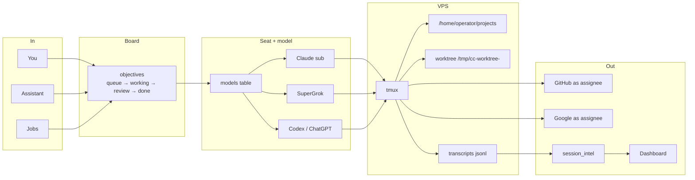

# How it works

The **objective** row is the source of truth. An agent finishing a sentence does not finish the card. Same story as a picture:

## Engines

| Engine | When | Auth |
| --- | --- | --- |
| Claude | Default coding / most cards | Claude subscription seats (rotation A–G). Connect on Dashboard. |
| Grok | Model `grok-4.6` | SuperGrok subscription. Dashboard → Grok → Connect (device code). Not an API key. |
| Codex | GPT-5.x models | ChatGPT subscription in the Codex home. |

Spawn unsets provider API keys so a session cannot silently fall through to pay-as-you-go.

## LLM gateway (for other apps, not for cards)

`/api/llm/v1` is a separate, OpenAI Chat Completions–shaped surface (`GET /models`,
`POST /chat/completions` with streaming and tool calls) that lets **other internal apps** —
first consumer: Twenty CRM's AI — run on the Claude subscription seats OperationKit already
manages, instead of paying per token on a separate API key. It is not part of the board loop:
no objective, no card, no tmux session.

- **One request = one headless `claude -p` turn** on an allowlisted seat, run from an empty
  directory with tools, MCP and hooks disabled. Tool/function calling is emulated through a
  strict JSON envelope in the prompt and translated back to OpenAI `tool_calls`.
- **Auth** is a single static bearer key, `TWENTY_LLM_GATEWAY_KEY` (Settings → Secrets) — not
  a `cc_live_` key and not OperationKit login. No key configured → 503 (fails closed).
- **Guardrails:** a seat allowlist (`LLM_GATEWAY_SLOTS`; default every seat except `a`,
  Mike's personal one), a global concurrency cap (`LLM_GATEWAY_MAX_CONCURRENCY`, default 3 →
  429 when full; an exhausted seat pool is also 429), and a kill switch
  (`LLM_GATEWAY_ENABLED=false` → 503) that an admin can flip without touching the seats.
- **Logging:** one line per request (model, seat, tokens, latency) to stdout and
  `/app/data/logs/llm-gateway.jsonl`. Prompts and completions are never logged.

Code: `app/server/src/routes/llm-gateway.ts`, `app/server/src/services/llm-gateway/`.

## Seats vs people

- **Seats** = Claude / Grok / Codex subscriptions. Shared, rotated, named on Dashboard.
- **People** = OperationKit users. GitHub PAT + Google OAuth on Settings → You.
- A card’s **assignee** is who the session acts as. If nobody is assigned, the creator.

## Where code lives

Sessions run as `ccuser` with `HOME` pointed at a seat directory. A card with a linked repo always works in `/tmp/cc-worktree-<id>/`, not the live checkout. The “open a PR” checkbox only chooses how the branch ships (own PR vs fold into a parent). Editing the live tree crashed production once; a hook now blocks those writes.

A PR is green when GitHub Actions job **`gate`** is green. That is the merge lock. An AI review may also comment; it is not the required check.

## What watches

A poller looks at tmux every few seconds: working vs waiting, death, rate limits, review. Dashboard spend is derived from session intel, not from the seat counters (those double-count follow-ups).

A running card is not a black box: workers write progress snapshots as they go, so the card shows what step it's on and any mid-run files it's produced, instead of going silent until the session ends. A card can also fan out into child cards for independent sub-work, run up to a concurrency ceiling, and roll results back up to the parent.
